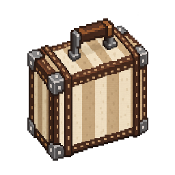

<p align="center"></p>

# Suitcase Glider
**Чемодан, который раскрывается в планер, когда земля становится слишком близко.**

[](https://www.minecraft.net/)
[](https://files.minecraftforge.net/)


**Русский** · [English](README_EN.md) · [Скачать мод](https://github.com/Deenfoool/suit-case-glider/raw/refs/heads/main/suitcaseglider-0.1.0.jar) · [Сообщить об ошибке](https://github.com/Deenfoool/suit-case-glider/issues)

---

## 🎒 О моде

**Suitcase Glider** — мод для Minecraft Java Edition, добавляющий переносной чемодан-планер. Держи его в основной руке: при опасном падении чемодан автоматически раскроет крыло и поможет безопаснее спуститься. Обычные короткие прыжки не вызывают раскрытия.

Это **не элитры**: планер предназначен для контролируемого снижения, а не для набора высоты или полёта с фейерверками. Слоты брони остаются свободными.

## ✨ Возможности

- **Автоматическое раскрытие.** Учитываются падение, расстояние до поверхности и безопасность приземления.
- **Управляемый спуск.** Движение связано с направлением взгляда; после посадки планер складывается.
- **Авторская 3D-модель и анимации.** Переноска, раскрытие, парение и складывание.
- **Окраска ткани.** Совмести чемодан с красителем в сетке крафта — каркас сохранит прежний цвет.
- **Прочность и ремонт.** 192 единицы прочности, износ во время полёта, починка кожей.
- **Зачарования.** «Прочность» и «Парение» (I–III); «Парение» уменьшает скорость снижения.
- **Сетевая игра.** Состояние планера синхронизируется между сервером и клиентами.

**Управление:** выбери чемодан в основной руке. Отдельная кнопка раскрытия не нужна. При смене предмета планер отключается; во время полёта атаки и взаимодействия недоступны, обе руки заняты.

## 🧵 Рецепт

| Кожа | Кожа | Кожа |
|:---:|:---:|:---:|
| Палка | Нить | Палка |
| Палка | — | Палка |

Крафт выполняется на обычном верстаке. После создания ткань можно перекрашивать с помощью красителей.

## 📥 Установка

| Требование | Версия |
|---|---|
| Minecraft Java Edition | **1.20.1** |
| Minecraft Forge | **47.4.28** (разработка/сборка) |
| Java для сборки | **JDK 17** |
| Дополнительные моды | **Не требуются** |

1. Установи Minecraft Forge для **Minecraft 1.20.1**.
2. Скачай [**Suitcase Glider 0.1.0 (.jar)**](https://github.com/Deenfoool/suit-case-glider/raw/refs/heads/main/suitcaseglider-0.1.0.jar).
3. Помести файл в папку `mods` нужного профиля Minecraft.
4. Запусти игру с профилем Forge.

Для мультиплеера мод должен быть установлен **и на сервере, и у игроков**. Наличие файла JAR в репозитории не означает, что он автоматически обновляется при изменениях исходников.

## 🛠 Сборка из исходников

Потребуются **JDK 17** и подключение к интернету для загрузки зависимостей Gradle.

```powershell
# Windows PowerShell
.\gradlew.bat build
```

```bash
# Linux / macOS
./gradlew build
```

Готовый JAR появится в каталоге `build/libs/`.

Тесты и служебные режимы:

```powershell
.\gradlew.bat test
.\gradlew.bat runServer -Psmoke
```

Флаги `-Pvisual` и `-Prendercheck` предназначены **только для разработки**: они работают с отдельным тестовым миром. Наличие тестов в исходниках не является заявлением об их прохождении на каждом компьютере.

## 🗂 Структура проекта

```text
src/
├── main/
│   ├── java/dev/salum/suitcaseglider/   # предмет, физика и синхронизация
│   └── resources/                        # модели, анимации, текстуры, локализация, рецепт
└── test/                                 # тесты правил полёта
gradle/                                   # Gradle Wrapper
build.gradle                              # конфигурация сборки
gradle.properties                         # версии Minecraft, Forge и мода
README_RU.md                              # подробные технические заметки
```

Редактируемые модели `.bbmodel`, упомянутые в [техническом README](README_RU.md), **не включены** в текущий репозиторий. В нём хранится игровой анимационный ресурс `glider_scene.json`.

## 📄 Лицензирование и обратная связь

В [метаданных проекта](gradle.properties) указано **All Rights Reserved**. Лицензии Minecraft Forge и его компонентов **не определяют автоматически** лицензию самого Suitcase Glider.

Нашёл ошибку или хочешь предложить улучшение? Открой [Issue](https://github.com/Deenfoool/suit-case-glider/issues) и укажи версию Minecraft/Forge, шаги воспроизведения и, если возможно, лог.

[Техническое описание на русском](README_RU.md) · [История версии](CHANGELOG.md) · [English README](README_EN.md)
